<p align="center"></p>

<h1 align="center">True Companion (addon)</h1>

<p align="center"><i>Formerly <b>AzerothRomance</b>. Upgrading? See <a href="#upgrading-from-azerothromance">Upgrading from AzerothRomance</a>.</i></p>

**Author:** [davidlovcov](https://github.com/davidlovcov)

World of Warcraft **3.3.5a** addon (Interface 30300) for the AzerothCore module **[mod-true-companion](https://github.com/davidlovcov/mod-true-companion)**: AI companions powered by mod-playerbots and a local Ollama model.

> This addon only works on servers that run **mod-true-companion**. All data (characters, relationship, memories, AI) lives on the server; the addon displays it and sends your requests.

## Screenshots

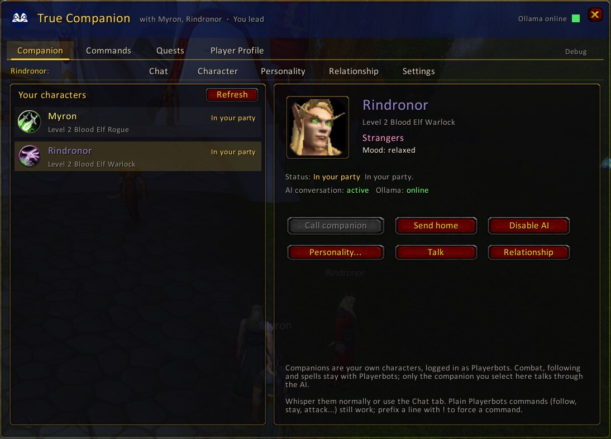

| | |
|---|---|
| 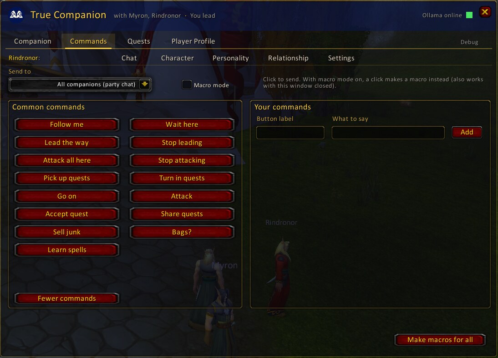 | 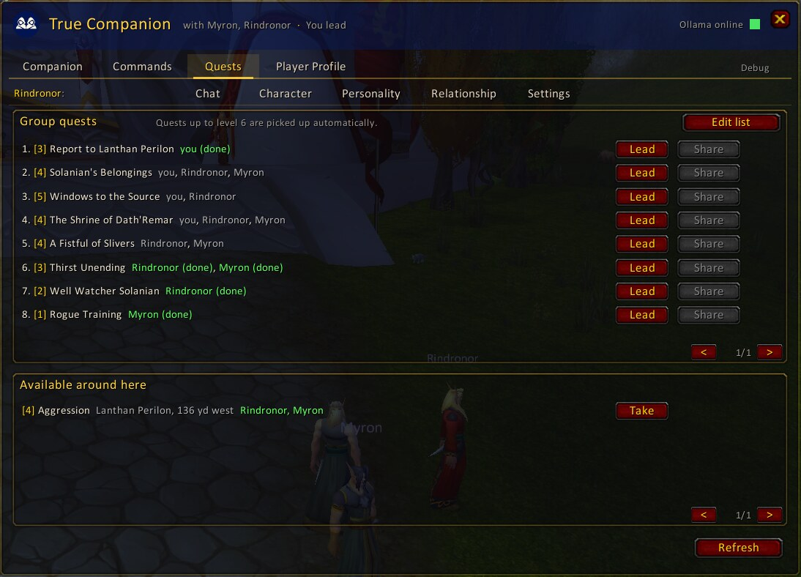 |
| **Commands**: one click for everyday orders, your own commands and macros | **Quests**: the group's quests, a quest order, lead, share and take |
| 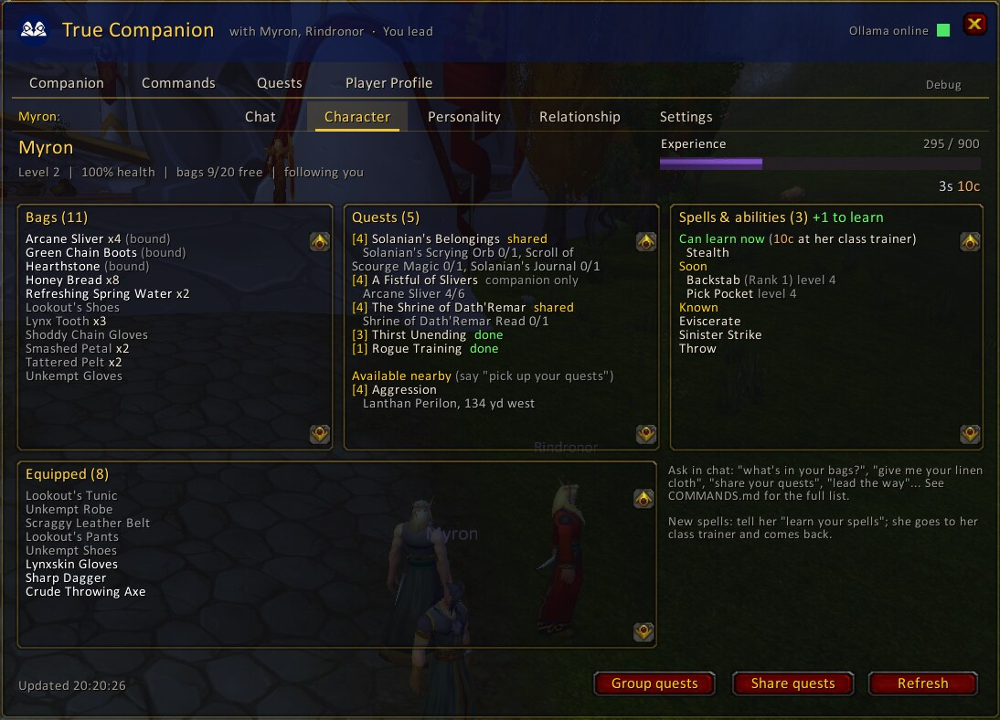 | 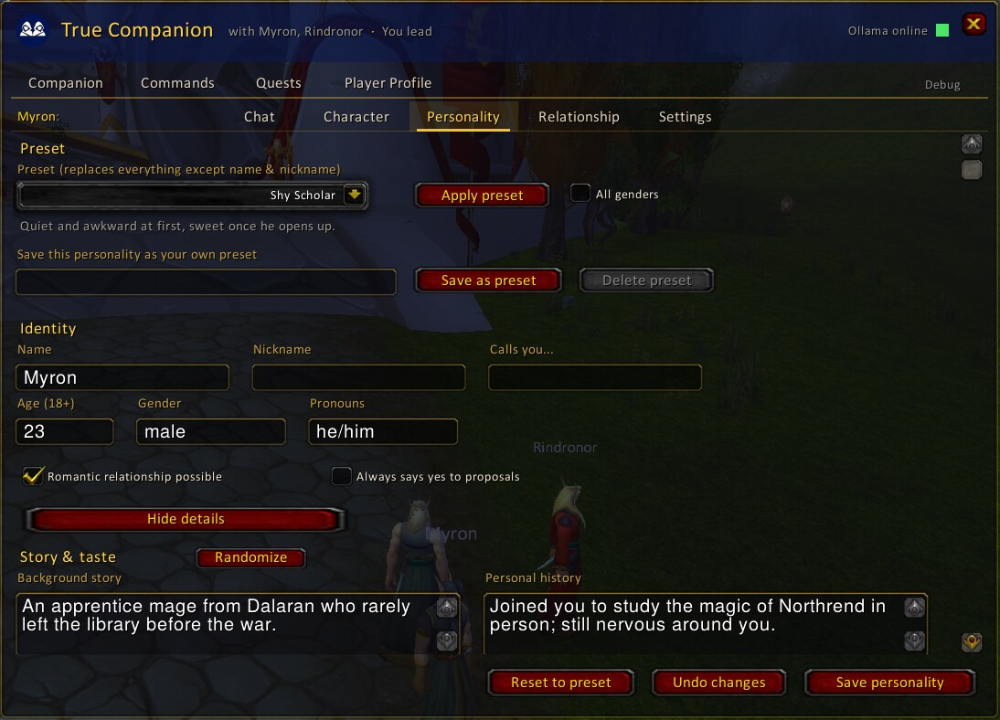 |
| **Character**: bags, gear, quests, spells to learn | **Personality** with presets and randomizer |
| 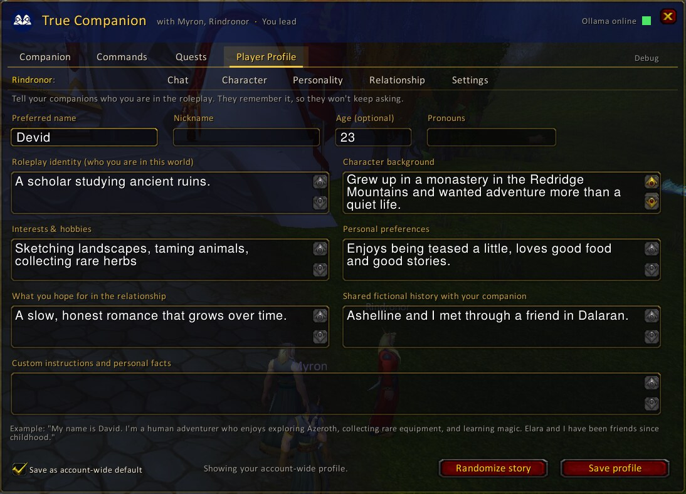 | 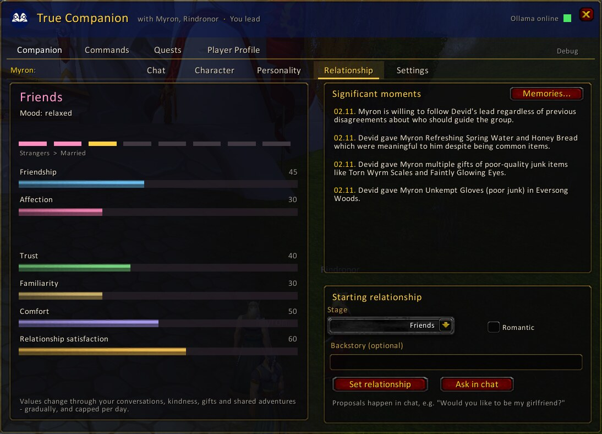 |
| **Player Profile**: who you are in the roleplay | **Relationship** values, stages and significant moments |
| 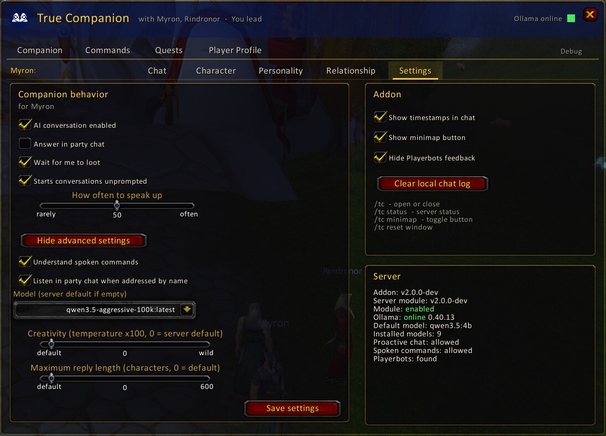 | 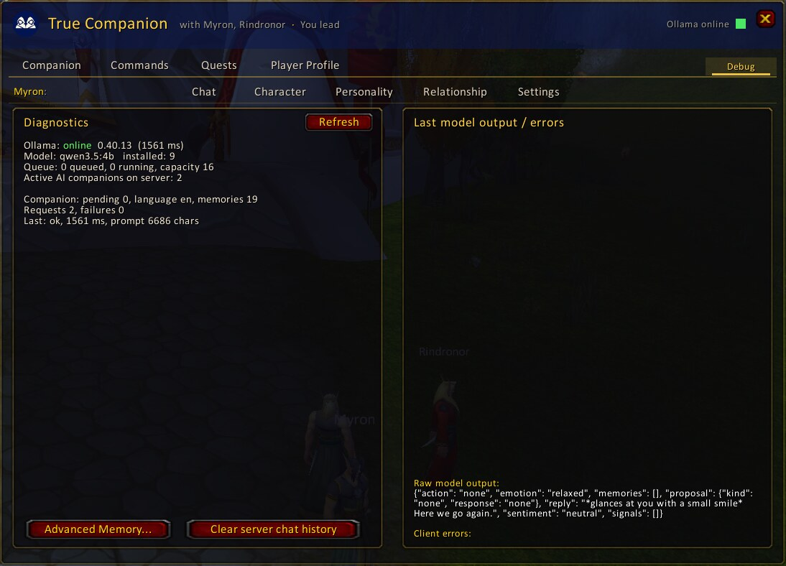 |
| **Settings** per companion, and the server's status | **Debug**: Ollama, queue and the model's last raw answer |

Several companions in party chat, each answering for themselves:

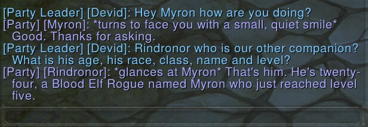

**Memories**: everything your companion remembers, with source and importance. Edit, pin, delete, add, export or import.

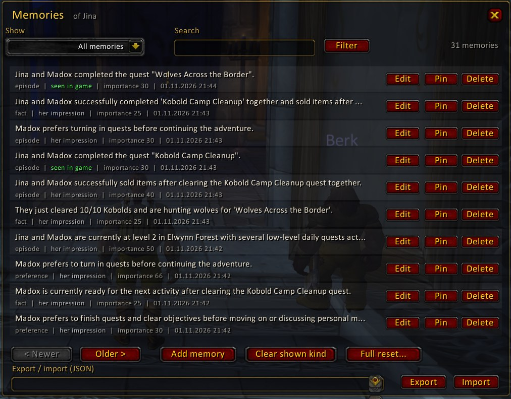

## Features

Everything is simple by default: each tab shows the everyday things, and the extras (quest order, advanced settings, personality details, more commands) are one click away.

The tabs come in two rows: on top the general ones (Companion, Commands, Quests, Player Profile), below them the tabs about the companion selected on the Companion tab (Chat, Character, Personality, Relationship, Settings), labelled with her name.

- **Companion:** your account's characters with level, race, class and live status. Unavailable characters are greyed out and explain why. Call or send home your companions (several at once), and turn their AI on or off. The window header names the companions that are really with you.
- **Chat:** conversation history with timestamps and a "thinking" indicator. Companions also answer by normal whisper. Lines starting with `!` are plain Playerbots commands.
- **Character:** the companion's level, XP, gold, bags, gear, quests (with progress and which you share) and spells, refreshed while the tab is open.
- **Quests:** the quests of your whole group and those available around: set the order the leading companion follows ("Apply order"), send her to one ("Lead"), share one with everyone who lacks it ("Share"), ignore quests you never want, abandon a quest for every companion. For each quest around it shows who could take it; "Take" makes them take it (they walk there together if the quest giver isn't close).
- **Commands:** one-click buttons for the common commands (follow, wait, lead the way, attack all here, pick up / turn in / share quests, sell junk, ...), sent to any companion who is with you ("Send to"; the selected one by default) or in party chat to all of them. Add your own commands ("lead me to the mine"). **Macro mode** turns any button into a WoW macro on your cursor for an action bar; **Make macros for all** creates them all at once.
- **Personality:** identity, story, 12 trait sliders, response styles, custom instructions and language. Complete presets for female and male companions (e.g. *Anime Girlfriend*, *Gentle Knight*), your own saved presets, **Reset to preset**, **Undo changes** and a **Randomize** button for story & taste.
- **Player Profile:** who you are in the roleplay, per character or account-wide, with its own randomizer.
- **Relationship:** stage, mood, all relationship values, significant moments, and the starting relationship.
- **Settings:** proactive chat, spoken commands, party chat, model and creativity (within the server's limits). "Hide Playerbots feedback" keeps lines like "Following" out of your chat window (they stay in the Chat tab, in gray).
- **Debug:** a small tab with diagnostics, raw model output and the **memory viewer** (filter, edit, pin, delete, add, export and import).
- Minimap button, `/tc` (or `/companion`), remembered window position.

## Installation

1. Download this repository: green **Code** button → **Download ZIP**, or take a release ZIP.
2. Copy the **`TrueCompanion`** folder into `World of Warcraft/Interface/AddOns/`, so that this path exists:
   `Interface/AddOns/TrueCompanion/TrueCompanion.toc`
3. Start the game and type `/tc`.

### Upgrading from AzerothRomance
1. Delete `Interface/AddOns/AzerothRomance` and install `TrueCompanion` as above (with a server running mod-true-companion 2.0; the old addon can't talk to it and the other way round).
2. To keep the addon's own settings (window position, your commands, ignored quests, memory exports), rename `WTF/Account/<ACCOUNT>/SavedVariables/AzerothRomance.lua` to `TrueCompanion.lua` before logging in. Everything else (companions, memories, relationships) lives on the server and is kept anyway.
3. `/tc` or `/companion` opens the window (was `/romance`, `/ar`). Memory exports made before the rename can still be imported.

With git:
```bash
git clone https://github.com/davidlovcov/azerothcore-true-companion-addon.git
# copy or symlink azerothcore-true-companion-addon/TrueCompanion into Interface/AddOns/
```
**Updating:** run `git pull` (or download again), then `/reload` in game.

## Commands

| Command | Action |
|---|---|
| `/tc` | open or close the window |
| `/tc status` | server and Ollama status |
| `/tc minimap` | show or hide the minimap button |
| `/tc reset window` | move the window back to the centre |

Everything you can say to a companion in chat ("give me 10 gold", "attack the wolf", "share your quests", "lead the way"...) is listed in [mod-true-companion/docs/COMMANDS.md](https://github.com/davidlovcov/mod-true-companion/blob/main/docs/COMMANDS.md).

## Tests

The addon is tested headless with Lua 5.1 against a strict stub of the 3.3.5a API, with simulated server traffic:
```bash
scripts/run-tests.sh
TRUE_COMPANION_WIRE=../mod-true-companion/build-tests/true_companion_wire scripts/run-tests.sh   # + wire-format interop with the server
```
The wire protocol is documented in [mod-true-companion/docs/ADDON_PROTOCOL.md](https://github.com/davidlovcov/mod-true-companion/blob/main/docs/ADDON_PROTOCOL.md).

## License

GPL-2.0-or-later, see [LICENSE](LICENSE). Textures are referenced from the game client; `TrueCompanion/Media/logo.tga` is original (the True Companion logo).

World of Warcraft® is a trademark of Blizzard Entertainment, Inc. This project isn't affiliated with or endorsed by Blizzard.
