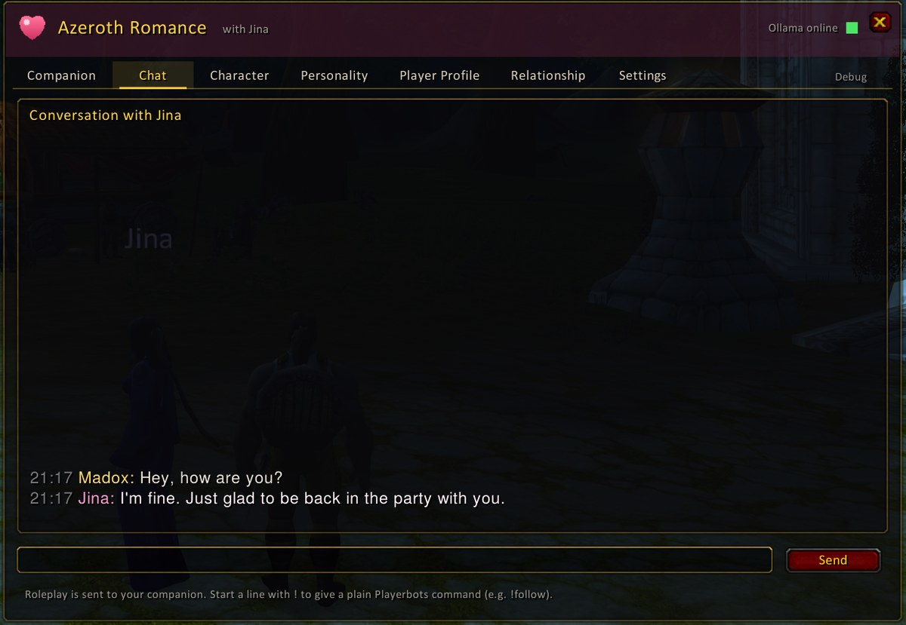

# AzerothRomance (addon)

**Author:** [davidlovcov](https://github.com/davidlovcov)

World of Warcraft **3.3.5a** addon (Interface 30300) for the AzerothCore module **[mod-romance](https://github.com/davidlovcov/mod-romance)**: AI companions powered by mod-playerbots and a local Ollama model.

> This addon only works on servers that run **mod-romance**. All data (characters, relationship, memories, AI) lives on the server; the addon displays it and sends your requests.

## Screenshots


| | |
|---|---|
|  |  |
| **Chat** with your companion | **Character**: bags, gear, quests, spells |
|  |  |
| **Personality** with presets and randomizer | **Player Profile**: who you are in the roleplay |
|  |  |
| **Relationship** values and stages | **Settings** per companion |

**Memories**: everything your companion remembers, with source and importance. Edit, pin, delete, add, export or import.


## Features

- **Companion:** your account's characters with level, race, class and live status. Unavailable characters are greyed out and explain why. Call or send home your companions (several at once), and turn their AI on or off. The window header names the companions that are really with you.
- **Chat:** conversation history with timestamps and a "thinking" indicator. Companions also answer by normal whisper. Lines starting with `!` are plain Playerbots commands.
- **Character:** the companion's level, XP, gold, bags, gear, quests (with progress and which you share) and spells, refreshed while the tab is open.
- **Personality:** identity, story, 12 trait sliders, response styles, custom instructions and language. Complete presets for female and male companions (e.g. *Anime Girlfriend*, *Gentle Knight*), your own saved presets, **Reset to preset**, **Undo changes** and a **Randomize** button for story & taste.
- **Player Profile:** who you are in the roleplay, per character or account-wide, with its own randomizer.
- **Relationship:** stage, mood, all relationship values, significant moments, and the starting relationship.
- **Settings:** proactive chat, spoken commands, party chat, model and creativity (within the server's limits). "Hide Playerbots feedback" keeps lines like "Following" out of your chat window (they stay in the Chat tab, in gray).
- **Debug:** a small tab with diagnostics, raw model output and the **memory viewer** (filter, edit, pin, delete, add, export and import).
- Minimap button, `/romance` (or `/ar`), remembered window position.

## Installation

1. Download this repository: green **Code** button → **Download ZIP**, or take a release ZIP.
2. Copy the **`AzerothRomance`** folder into `World of Warcraft/Interface/AddOns/`, so that this path exists:
   `Interface/AddOns/AzerothRomance/AzerothRomance.toc`
3. Start the game and type `/romance`.

With git:
```bash
git clone https://github.com/davidlovcov/azerothcore-romance-addon.git
# copy or symlink azerothcore-romance-addon/AzerothRomance into Interface/AddOns/
```
**Updating:** run `git pull` (or download again), then `/reload` in game.

## Commands

| Command | Action |
|---|---|
| `/romance` | open or close the window |
| `/romance status` | server and Ollama status |
| `/romance minimap` | show or hide the minimap button |
| `/romance reset window` | move the window back to the centre |

Everything you can say to a companion in chat ("give me 10 gold", "attack the wolf", "share your quests", "lead the way"...) is listed in [mod-romance/docs/COMMANDS.md](https://github.com/davidlovcov/mod-romance/blob/main/docs/COMMANDS.md).

## Tests

The addon is tested headless with Lua 5.1 against a strict stub of the 3.3.5a API, with simulated server traffic:
```bash
scripts/run-tests.sh
ROMANCE_WIRE=../mod-romance/build-tests/romance_wire scripts/run-tests.sh   # + wire-format interop with the server
```
The wire protocol is documented in [mod-romance/docs/ADDON_PROTOCOL.md](https://github.com/davidlovcov/mod-romance/blob/main/docs/ADDON_PROTOCOL.md).

## License

GPL-2.0-or-later, see [LICENSE](LICENSE). Textures are referenced from the game client; `AzerothRomance/Media/heart.tga` is original.

World of Warcraft® is a trademark of Blizzard Entertainment, Inc. This project isn't affiliated with or endorsed by Blizzard.
